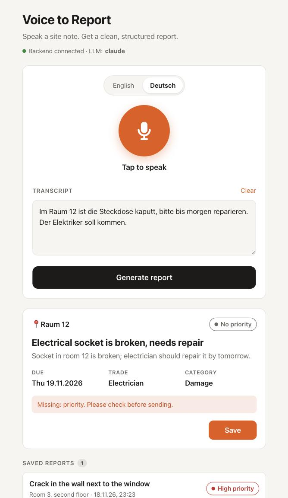
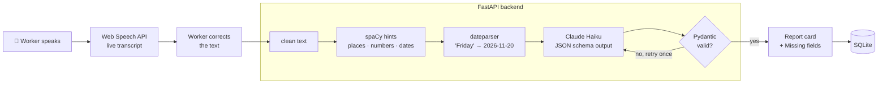

# Voice to Report

[](https://github.com/RinaSh1/voice-to-report-app/actions/workflows/ci.yml)

A construction worker **speaks** a short site note, in English or German. The app turns it into a **clean, structured report** that the office can check, save and act on.

Anything the worker didn't say stays empty and is flagged as **Missing**. The app never guesses.



> 🎥 Demo video: *coming soon*

## How it works



| Step | Where | Why |
|---|---|---|
| Speech to text | Browser (Web Speech API) | Free and live while the worker speaks |
| Clean + hints | `backend/app/nlp.py` (spaCy) | Classic NLP finds places like "room 3", "2. Stock" and date words in both languages |
| Real dates | `nlp.py` (dateparser) | LLMs are bad at calendar maths, so "Friday" / "morgen" become real dates *before* the LLM sees them |
| Structuring | `backend/app/report_service.py` + `llm/` | The LLM fills a JSON schema made from the Pydantic model |
| Validation | Pydantic | Wrong values (e.g. priority "Urgent") are rejected; the LLM gets one retry with the exact error |
| Never guess | `models.py` | Optional fields stay `null` and are listed in `missing_fields` |

### Example

> "Room 3 on the second floor, there's a **crock** in the wall next to the window. Needs to be fixed by Friday, high priority. Tell the plasterer."

```json
{
  "location": "Room 3, second floor",
  "issue": "Crack in the wall next to the window",
  "category": "Damage",
  "priority": "High",
  "due_date": "2026-11-20",
  "assigned_trade": "Plasterer",
  "summary": "Crack in the wall next to the window in Room 3 on the second floor needs fixing by Friday.",
  "language": "en",
  "missing_fields": []
}
```

The speech-to-text mistake "crock" is fixed to "crack", and "Friday" becomes a real date.

## Evaluation

`backend/eval/` holds 10 sample notes (6 English, 4 German) with the expected fields. Run them through the real pipeline:

```
cd backend && python -m eval.evaluate
```

Result with Claude Haiku 5.5:

| Field | Accuracy |
|---|---|
| location | 90% |
| issue | 100% |
| category | 100% |
| priority | 100% |
| due_date | 100% |
| assigned_trade | 90% |
| **overall** | **97%** |

A guessed value where the worker said nothing counts as **wrong**. Remaining mistakes: "hallway" was left out of one location, and *Fliesenleger* (tiler) was reported as plasterer.

## Tech stack

- **Frontend:** React 19 + TypeScript, Vite, Vitest + Testing Library
- **Backend:** Python, FastAPI, Pydantic, spaCy (`en_core_web_sm`, `de_core_news_sm`), dateparser, SQLite
- **LLM:** Claude Haiku 5.5 with structured outputs (default), or Ollama (free, local) via `LLM_PROVIDER=ollama`
- **CI:** GitHub Actions runs ESLint, Vitest, the build and pytest on every push

The LLM sits behind a small interface (`llm/base.py`), so providers can be swapped without touching the rest of the app. All tests use a fake LLM: no API key and no cost.

## Run it locally

Requirements: Python 3.11+, Node 20 (`nvm use`), Google Chrome (best speech recognition).

**Backend**

```
cd backend
python3 -m venv .venv && source .venv/bin/activate
pip install -r requirements.txt
python -m spacy download en_core_web_sm
python -m spacy download de_core_news_sm
uvicorn app.main:app --reload
```

Claude credentials: run `ant auth login` once, or set `ANTHROPIC_API_KEY` (see `.env.example`). Never commit a key.

**Frontend** (in a second terminal)

```
cd frontend
nvm use
npm install
npm run dev
```

Open http://localhost:5173 in Chrome and allow the microphone.

**Tests**

```
cd backend && pytest
cd frontend && npm test
```

## Project structure

```
backend/app/
  main.py            API routes
  models.py          Report (Pydantic) + missing_fields
  nlp.py             spaCy hints + date conversion
  report_service.py  transcript → validated report (with retry)
  llm/               base.py (interface), claude.py, ollama.py
  db.py              SQLite storage
backend/eval/        10 samples + accuracy script
frontend/src/
  components/        RecordButton, TranscriptView, ReportCard, ReportList
  hooks/             useSpeechRecognition
  services/api.ts    calls to the backend
```

## Design decisions

- **Tap to start / tap to stop** instead of hold, which is easier with work gloves. Big buttons and text, mobile first.
- **The worker can edit the transcript** before generating, because speech recognition makes mistakes.
- **The priority badge uses text + colour**, not colour alone.
- **Loading, error and empty states** are always visible, so the app never looks stuck.

## What I learned

- *[Your words: e.g. why validate LLM output, why dates are converted before the LLM]*

## Next steps

- Whisper (`faster-whisper`) as an offline speech-to-text option, and Swiss German
- Photos attached to a report
- Export to PDF for the office
