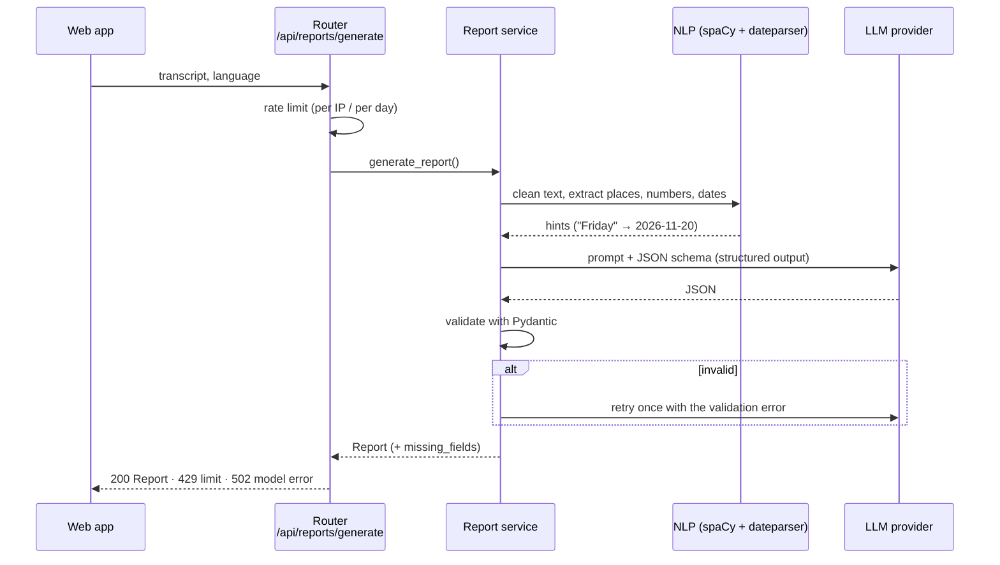

# Voice to Report

[](https://github.com/RinaSh1/voice-to-report-app/actions/workflows/ci.yml)

A construction worker **speaks** a short site note, in English or German. The app turns it into a **clean, structured report** that the office can check, save and act on.

Anything the worker didn't say stays empty and is flagged as **Missing**. The app never guesses.

**▶ Live demo: [voice-to-report.onrender.com](https://voice-to-report.onrender.com)** (use Chrome and allow the microphone, or type a note). It runs on Render's free plan, so the first report after a quiet period can take about a minute while the server wakes up. Saved reports reset when the server restarts.


## Example

> "Room 3 on the second floor, there's a **crock** in the wall next to the window. Needs to be fixed by Friday, high priority. Tell the plasterer."

```json
{
  "location": "Room 3, second floor",
  "issue": "Crack in the wall next to the window",
  "category": "Damage",
  "priority": "High",
  "due_date": "2026-11-20",
  "assigned_trade": "Plasterer",
  "summary": "Crack in the wall next to the window in Room 3 on the second floor needs fixing by Friday.",
  "language": "en",
  "missing_fields": []
}
```

The speech-to-text mistake "crock" is fixed to "crack", and "Friday" becomes a real date.

## Architecture

A monorepo with two deployable apps:

| App | Stack | Responsibility |
|---|---|---|
| `apps/web` | React 19, TypeScript, Vite | Recording, transcript editing, report review, saved list |
| `apps/api` | Python, FastAPI, Pydantic, spaCy | NLP, LLM structuring, validation, persistence, rate limiting |

### Request flow: generating a report



### API layers (`apps/api/app`)

```
main.py          app factory, maps domain errors to HTTP (429, 502)
api/             routers + dependencies (LLM, repository, rate limiter)
core/            settings (pydantic-settings), domain errors, rate limiter
services/        nlp.py (spaCy, dateparser) · report_service.py (prompt, validation, retry)
llm/             LLMProvider protocol · factory · Claude · Ollama
schemas/         Pydantic models: Report, requests, saved items
db/              ReportRepository (SQLite)
```

Dependencies only point inwards: routers → services → schemas. Services don't know about HTTP, and the report service only sees the `LLMProvider` protocol, so providers can be swapped by configuration (`LLM_PROVIDER=claude|ollama`) and replaced by a fake in tests.

### Web app (`apps/web/src`)

```
app/             App: composition only, no business logic
features/
  recording/     useSpeechRecognition (Web Speech API), RecordButton, TranscriptView, LanguageSwitch
  reports/       useReports (generate, save, list state), ReportCard, PriorityBadge, ReportList, API calls, types
  health/        API status line
lib/             typed JSON HTTP client (ApiError), date formatting
test/            test setup, fake speech recogniser, fake API
```

Each feature exposes a small public surface through its `index.ts`. State and side effects live in hooks (`useSpeechRecognition`, `useReports`), so components stay presentational.

### Key decisions

- **Dates are resolved before the LLM.** Calendar arithmetic ("Friday", "morgen") is done deterministically with dateparser; the model only places the resolved date.
- **Structured output + validation + one retry.** The JSON schema is generated from the Pydantic model, and the API constrains the output to it. The result is still validated, and a single retry includes the exact validation error.
- **Never guess.** Optional fields stay `null`. `missing_fields` is computed from the model, not produced by the LLM.
- **One origin.** The web app calls `/api/*` on its own host (Vite proxy locally, Render rewrite in production), so no CORS configuration is needed.
- **Cost protection.** The public demo is limited to 20 reports per hour per visitor and 200 per day overall.

## Evaluation

`apps/api/eval/` holds 10 sample notes (6 English, 4 German) with the expected fields. Run them through the real pipeline:

```
cd apps/api && python -m eval.evaluate
```

Result with Claude Haiku 5.5:

| Field | Accuracy |
|---|---|
| location | 90% |
| issue | 100% |
| category | 100% |
| priority | 100% |
| due_date | 100% |
| assigned_trade | 90% |
| **overall** | **97%** |

A guessed value where the worker said nothing counts as **wrong**. Remaining mistakes: "hallway" was left out of one location, and *Fliesenleger* (tiler) was reported as plasterer.

## Quality

| | API | Web app |
|---|---|---|
| Tests | pytest (unit + API), LLM always faked | Vitest + Testing Library, speech and API faked |
| Lint / format | ruff | ESLint, TypeScript strict |
| CI | GitHub Actions on every push and pull request | GitHub Actions on every push and pull request |

## Run it locally

Requirements: Python 3.11+, Node 20 (`nvm use`), Google Chrome (best speech recognition).

**API**

```
cd apps/api
python3 -m venv .venv && source .venv/bin/activate
pip install -r requirements-dev.txt
python -m spacy download en_core_web_sm
python -m spacy download de_core_news_sm
uvicorn app.main:app --reload
```

LLM credentials: run `ant auth login` once, or set `ANTHROPIC_API_KEY` (see `.env.example`). Never commit a key.

**Web app** (second terminal)

```
cd apps/web
nvm use
npm install
npm run dev
```

Open http://localhost:5173 in Chrome and allow the microphone.

**Checks**

```
cd apps/api && ruff check . && pytest
cd apps/web && npx eslint . && npm test
```

## Deployment

`render.yaml` defines both services on Render: the API as a Python web service, and the web app as a static site that rewrites `/api/*` to the API. The LLM key is set in Render's dashboard, never in the repository.

## Design decisions (UX)

- **Tap to start / tap to stop** instead of hold, which is easier with work gloves. Big buttons and text, mobile first.
- **The worker can edit the transcript** before generating, because speech recognition makes mistakes.
- **The priority badge uses text + colour**, not colour alone.
- **Loading, error and empty states** are always visible, so the app never looks stuck.

## What I learned

- *[Your words: e.g. why validate LLM output, why dates are converted before the LLM]*

## Next steps

- Whisper (`faster-whisper`) as an offline speech-to-text option, and Swiss German
- Photos attached to a report
- Export to PDF for the office
